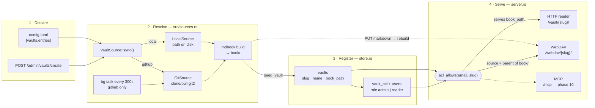

# MoriNet

> Server [mdBook](https://rust-lang.github.io/mdBook/) that exposes an LLM-Wiki style knowledge base brain with multi-user auth, WebDAV, and MCP.

[](https://github.com/lejeunecedric/MoriNet/actions/workflows/ci.yml)
[](https://github.com/lejeunecedric/MoriNet/releases)
[](#license)

> 🚧 **Active development** — v0.1.7, phases 00→06 shipped. Next up: phase 07 *vault-ux*. See [`.planning/ROADMAP.md`](.planning/ROADMAP.md).

## What

- 📚 Serves one or more Obsidian vaults (compiled to mdbook) over HTTP
- 🔐 Email + password auth (HttpOnly signed cookies)
- 👤 `admin` / `reader` roles
- 📂 Sources = local folder OR GitHub repo (clone + periodic sync)
- 📡 Vaults accessible via **WebDAV** (same creds as mdbook)
- 🤖 Vaults accessible via **MCP** (Model Context Protocol) — for AI agents
- 📨 Invitations and password reset by email
- 🎨 Custom mdbook visual mods: image zoom, collapsible sections, external links
- 📦 Single static Rust binary — `cargo install --git ...` (crates.io lands in phase +11)

## Install

> From git until phase +11 publishes to crates.io.

```bash
cargo install --git https://github.com/lejeunecedric/MoriNet morinet
```

## Quick start

```bash
# 1. Generate an example config.toml
morinet init --out ./config.toml

# 2. Edit it (cookie_secret is required: `openssl rand -hex 32`)
$EDITOR ./config.toml

# 3. Start the server (Phase 1+)
morinet serve --config ./config.toml
# → http://localhost:8080
```

## Status

| Phase | Goal | Status |
|-------|------|--------|
| 00 bootstrap | repo + Cargo scaffold + CI | ✅ |
| 01 core-serve | one vault + simple login | ✅ |
| 02 multi-vault | sub-paths /vaultA/, /vaultB/ | ✅ |
| 03 vault-sources | local + GitHub sources | ✅ |
| 04 admin-ui | invite, perms, vault mgmt | ✅ |
| 05 email | SMTP + invitations + reset | ✅ |
| 06 webdav | WebDAV exposure | ✅ |
| 07 vault-ux | server-side folder picker for local vaults | ⬜ next |
| 08 access-model | groups + personal vaults | ⬜ |
| 09 ux-nav | new shell: my vaults, account menu | ⬜ |
| 10 mcp | MCP StreamableHttp | ⬜ |
| 11 polish | installer + README + release v1.0 | ⬜ |

**Live**: [morinet.treklair.fr](https://morinet.treklair.fr) — public demo instance (no real data; credentials not in this repo). **Handoff notes for agents**: [`.planning/HANDOFF.md`](.planning/HANDOFF.md).

See [`.planning/REQUIREMENTS.md`](.planning/REQUIREMENTS.md) for the 91 REQ-IDs catalog.

## Architecture & decisions

All architectural decisions are tracked in [`.planning/STATE.md`](.planning/STATE.md) (AD-1 to AD-13) with rationale. Key points:

- **Stack 100% Rust** (single-crate `morinet`)
- **mdbook upstream** + a "mori" theme injected via `additional-css` / `additional-js` (no fork)
- **SQLite by default** (sqlx), file at `data/morinet.db`
- **HttpOnly signed cookies** (HMAC) + bcrypt for passwords
- **WebDAV** = 3 custom axum handlers (~200 lines, full control)
- **MCP** via the `rmcp` crate, StreamableHttp

### Vaults & services

A vault is declared once (config file or admin form), resolved to a local book
directory, then registered in SQLite. From there **three services** read the
same vault — and they do not read the same thing.



Three points worth knowing:

- **Kind lives in config, not in SQLite.** `vaults` stores only `slug`, `name`
  and `book_path` — `kind` (`local` | `github`) and the git URL are re-read from
  `config.toml` on every boot. A vault created from the admin form is not
  persisted as a source, only as a path.
- **The two live services sit on opposite sides of the build.** HTTP serves the
  compiled `book/`; WebDAV writes to the **source** (`source_dir_of` = parent of
  `book/`) and rebuilds, which is the useful direction for a second brain: you
  PUT markdown, mdBook renders it.
- **Access is one rule, one gate.** `acl_allows(email, slug)` returns `true` for
  any `admin` when the vault exists, otherwise requires a `vault_acl` row. It
  sits between the registry and the services, so `/vault/*` and `/webdav/*` share
  it (WebDAV additionally over HTTP Basic); MCP will be the third caller. PUT is
  admin-only even with a granted ACL.

## License

MIT OR Apache-2.0 — see [LICENSE](LICENSE).

## Credits

- Inspired by the works of **Andrej Karpathy** on LLM-Wiki — [gist: llm-wiki.md](https://gist.github.com/karpathy/442a6bf555914893e9891c11519de94f)
- Early-phase development during the **FRAMES** IBC Accelerator project — [showcase: Federated Retrieval, Agentic Media Environment and Software-Defined Workflows](https://show.ibc.org/ibc2026/accelerator-frames-federated-retrieval-agentic-media-environment-and-software-defined-workflows)
- Inputs from the **Réseau Intelligence de la Complexité** AI workgroup — [intelligence-complexite.org](https://www.intelligence-complexite.org)
