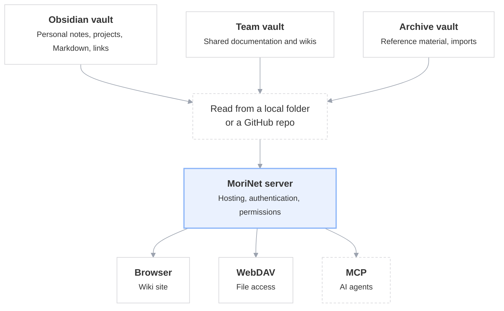

# MoriNet

> Server [mdBook](https://rust-lang.github.io/mdBook/) that exposes an LLM-Wiki style knowledge base brain with multi-user auth, WebDAV, and MCP.

[](https://github.com/lejeunecedric/MoriNet/actions/workflows/ci.yml)
[](https://github.com/lejeunecedric/MoriNet/releases)
[](#license)

> 🚧 **Active development** — v0.1.7, phases 00→06 shipped. Next up: phase 07 *vault-ux*. See [`.planning/ROADMAP.md`](.planning/ROADMAP.md).

## What

- 📚 Serves one or more Obsidian vaults (compiled to mdbook) over HTTP
- 🔐 Email + password auth (HttpOnly signed cookies)
- 👤 `admin` / `reader` roles
- 📂 Sources = local folder OR GitHub repo (clone + periodic sync)
- 📡 Vaults accessible via **WebDAV** (same creds as mdbook)
- 🤖 Vaults accessible via **MCP** (Model Context Protocol) — for AI agents
- 📨 Invitations and password reset by email
- 🎨 Custom mdbook visual mods: image zoom, collapsible sections, external links
- 📦 Single static Rust binary — `cargo install --git ...` (crates.io lands in phase +11)

## Install

> From git until phase +11 publishes to crates.io.

```bash
cargo install --git https://github.com/lejeunecedric/MoriNet morinet
```

## Quick start

```bash
# 1. Generate an example config.toml
morinet init --out ./config.toml

# 2. Edit it (cookie_secret is required: `openssl rand -hex 32`)
$EDITOR ./config.toml

# 3. Start the server (Phase 1+)
morinet serve --config ./config.toml
# → http://localhost:8080
```

## Status

| Phase | Goal | Status |
|-------|------|--------|
| 00 bootstrap | repo + Cargo scaffold + CI | ✅ |
| 01 core-serve | one vault + simple login | ✅ |
| 02 multi-vault | sub-paths /vaultA/, /vaultB/ | ✅ |
| 03 vault-sources | local + GitHub sources | ✅ |
| 04 admin-ui | invite, perms, vault mgmt | ✅ |
| 05 email | SMTP + invitations + reset | ✅ |
| 06 webdav | WebDAV exposure | ✅ |
| 07 vault-ux | server-side folder picker for local vaults | ⬜ next |
| 08 access-model | groups + personal vaults | ⬜ |
| 09 ux-nav | new shell: my vaults, account menu | ⬜ |
| 10 mcp | MCP StreamableHttp | ⬜ |
| 11 polish | installer + README + release v1.0 | ⬜ |

**Live**: [morinet.treklair.fr](https://morinet.treklair.fr) — public demo instance (no real data; credentials not in this repo). **Handoff notes for agents**: [`.planning/HANDOFF.md`](.planning/HANDOFF.md).

See [`.planning/REQUIREMENTS.md`](.planning/REQUIREMENTS.md) for the 91 REQ-IDs catalog.

## Architecture & decisions

All architectural decisions are tracked in [`.planning/STATE.md`](.planning/STATE.md) (AD-1 to AD-13) with rationale. Key points:

- **Stack 100% Rust** (single-crate `morinet`)
- **mdbook upstream** + a "mori" theme injected via `additional-css` / `additional-js` (no fork)
- **SQLite by default** (sqlx), file at `data/morinet.db`
- **HttpOnly signed cookies** (HMAC) + bcrypt for passwords
- **WebDAV** = 3 custom axum handlers (~200 lines, full control)
- **MCP** via the `rmcp` crate, StreamableHttp

### How it works

Obsidian vaults, hosted and shared by the MoriNet server.



A vault is a plain mdBook repo (`book.toml` + `src/SUMMARY.md`). The server
reads it from a local folder or a GitHub clone, compiles it with `mdbook build`,
and serves the result. Dotted outline = not shipped yet: MCP lands in phase 10.

Two details worth knowing:

- **Vault sources live in `config.toml`, not in SQLite.** The `vaults` table
  stores only `slug`, `name` and `book_path`; the kind (`local` | `github`) and
  the git URL are re-read from the config on every boot.
- **The two live services sit on opposite sides of the build.** The browser gets
  the compiled `book/`; WebDAV writes to the **source** and rebuilds — the useful
  direction for a second brain, where you PUT markdown and mdBook renders it.
  PUT is admin-only even with a granted ACL.

## License

MIT OR Apache-2.0 — see [LICENSE](LICENSE).

## Credits

- The name **MoriNet** is a nod to **Edgar Morin**, the French philosopher of
  complexity — [Wikipedia (EN)](https://en.wikipedia.org/wiki/Edgar_Morin).
- Inspired by the works of **Andrej Karpathy** on LLM-Wiki — [gist: llm-wiki.md](https://gist.github.com/karpathy/442a6bf555914893e9891c11519de94f)
- Early-phase development during the **FRAMES** IBC Accelerator project — [showcase: Federated Retrieval, Agentic Media Environment and Software-Defined Workflows](https://show.ibc.org/ibc2026/accelerator-frames-federated-retrieval-agentic-media-environment-and-software-defined-workflows)
- Inputs from the **Réseau Intelligence de la Complexité** AI workgroup — [intelligence-complexite.org](https://www.intelligence-complexite.org)
