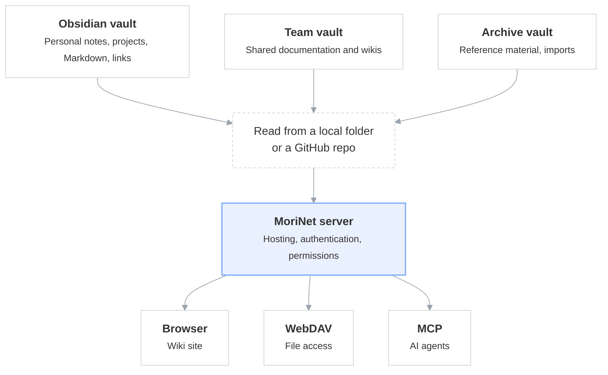

# MoriNet — Architecture & Credits

> This document was split out of the repository README at v1.0.0.
> Back to the [README](../README.md).

## Architecture & decisions

All architectural decisions are tracked in [`.planning/STATE.md`](../.planning/STATE.md) (the AD log) with rationale. Key points:

- **Stack 100% Rust** (single-crate `morinet`)
- **mdbook upstream** + a "mori" theme injected via `additional-css` / `additional-js` (no fork)
- **SQLite by default** (sqlx), file at `data/morinet.db`
- **HttpOnly signed cookies** (HMAC) + bcrypt for passwords
- **WebDAV** = 3 custom axum handlers (~200 lines, full control)
- **MCP** via the `rmcp` crate, StreamableHttp, authenticated with per-user API tokens (Bearer)

### How it works

Obsidian vaults, hosted and shared by the MoriNet server.

A vault is a plain mdBook repo (`book.toml` + `src/SUMMARY.md`). The server
reads it from a local folder or a GitHub clone, compiles it with `mdbook build`,
and serves the result.

Two details worth knowing:

- **Vault sources live in `config.toml`, not in SQLite.** The `vaults` table
  stores only `slug`, `name` and `book_path`; the kind (`local` | `github`) and
  the git URL are re-read from the config on every boot.
- **The two live services sit on opposite sides of the build.** The browser gets
  the compiled `book/`; WebDAV writes to the **source** and rebuilds — the useful
  direction for a second brain, where you PUT markdown and mdBook renders it.
  PUT is admin-only even with a granted ACL.

For the operational view (delivery pipeline, pitfalls, per-phase "how it works"
notes), see [`.planning/HANDOFF.md`](../.planning/HANDOFF.md); the full AD log
lives in [`.planning/STATE.md`](../.planning/STATE.md).

## Credits

- The name **MoriNet** is a nod to **Edgar Morin**, the French philosopher of
  complexity — [Wikipedia (EN)](https://en.wikipedia.org/wiki/Edgar_Morin).
- Inspired by the works of **Andrej Karpathy** on LLM-Wiki — [gist: llm-wiki.md](https://gist.github.com/karpathy/442a6bf555914893e9891c11519de94f)
- Early-phase development during the **FRAMES** IBC Accelerator project — [showcase: Federated Retrieval, Agentic Media Environment and Software-Defined Workflows](https://show.ibc.org/ibc2026/accelerator-frames-federated-retrieval-agentic-media-environment-and-software-defined-workflows)
- Inputs from the **Réseau Intelligence de la Complexité** AI workgroup — [intelligence-complexite.org](https://www.intelligence-complexite.org)
